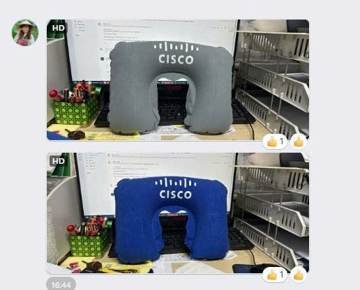
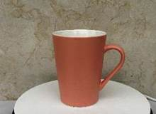
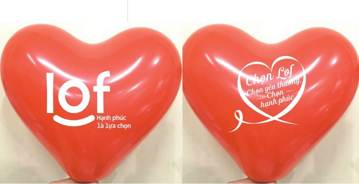
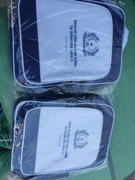
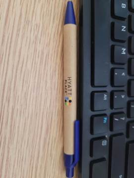

# Bài nháp Facebook EPVINA – tuần 2026-W46

Tạo lúc 07/11/2026 01:28 bằng `scripts/tao_bai_nhap_facebook.py`. **Tất cả bài đang ở trạng thái chờ duyệt — chưa đăng gì.**

Trước khi đăng, người duyệt kiểm tra:
- Thông số sản phẩm đúng với hàng hiện có; số lượng tối thiểu còn đúng.
- Bài không nêu số tiền (giá trong dữ liệu chưa đối chiếu bảng giá bán lẻ hiện hành).
- Mỗi bài mới có 1 ảnh sản phẩm từ dữ liệu báo giá — nên bổ sung 2–4 ảnh thật theo bộ 5 ảnh chuẩn (file nền 02).
- Giờ đăng là mặc định của script; chỉnh theo khung giờ trong file nền 02 nếu khác.
- Duyệt xong: sửa `trang_thai` trong `posts.json` thành `da_duyet`.

## Bài 1 – 14.1 gối hơi

- **Sản phẩm:** Gối hơi tự động - Chất liệu: PVC phủ nhung
- **Giờ đăng đề xuất:** Thứ Hai 09/11/2026, 11:30
- **Overlay ảnh bìa:** Gối hơi – từ 1.000 sp
- **Ảnh:** `anh/bai01.jpg`



**Caption:**

```text
📌 Gối hơi tự động in logo – nhận đơn từ 1.000 sản phẩm.

Quà tặng sự kiện cần đúng ngân sách và kịp ngày giao.
Epvina báo giá theo từng mức số lượng để anh/chị chủ động dự toán.

✅ Chất liệu: PVC phủ nhung
✅ 3 mức giá theo số lượng, bắt đầu từ 1.000 sản phẩm
✅ In logo tại xưởng Hà Nội, in thử duyệt màu trước khi chạy hàng loạt
✅ Epvina kiểm hàng và đóng gói trước khi giao – 13 năm làm quà tặng doanh nghiệp

👉 Inbox Epvina số lượng, ngân sách và ngày cần nhận để được báo giá.
☎️ Hotline: 024.3767.8915 – 0903.296.006

#Epvina #quatangdoanhnghiep #goihoiinlogo #quatangsukien
```

## Bài 2 – 1.4 cốc sứ

- **Sản phẩm:** Cốc vát cao màu kem lòng xanh cốm men mát mờ: D9cm H12cm, 500ml
- **Giờ đăng đề xuất:** Thứ Tư 11/11/2026, 11:30
- **Overlay ảnh bìa:** Cốc sứ – từ 500 sp
- **Ảnh:** `anh/bai02.jpg`



**Caption:**

```text
500 sản phẩm trở lên là Epvina nhận in logo cốc vát cao màu kem lòng xanh.

Phòng hành chính – nhân sự thường cần chốt quà nhanh mà vẫn đúng logo, đúng màu.
Epvina gửi bản in thử để anh/chị duyệt trước.

✅ 3 mức giá theo số lượng, bắt đầu từ 500 sản phẩm
✅ In logo tại xưởng Hà Nội, in thử duyệt màu trước khi chạy hàng loạt
✅ Epvina kiểm hàng và đóng gói trước khi giao – 13 năm làm quà tặng doanh nghiệp

👉 Inbox Epvina số lượng, ngân sách và ngày cần nhận để được báo giá.
☎️ Hotline: 024.3767.8915 – 0903.296.006

#Epvina #quatangdoanhnghiep #cocsuinlogo #quatangsukien
```

## Bài 3 – 12.5 bóng bay

- **Sản phẩm:** BÓNG BAY Loại mỏng (25cm)
- **Giờ đăng đề xuất:** Thứ Năm 12/11/2026, 20:00
- **Overlay ảnh bìa:** Bóng bay – từ 10.000 sp
- **Ảnh:** `anh/bai03.jpg`



**Caption:**

```text
Cần BÓNG BAY Loại mỏng in logo cho sự kiện? Đơn từ 10.000 sản phẩm.

Một món quà có logo được dùng hằng ngày giúp thương hiệu ở lại lâu với khách hàng và nhân viên.
Epvina tư vấn mẫu theo dịp tặng và ngân sách.

✅ 5 mức giá theo số lượng, bắt đầu từ 10.000 sản phẩm
✅ In logo tại xưởng Hà Nội, in thử duyệt màu trước khi chạy hàng loạt
✅ Epvina kiểm hàng và đóng gói trước khi giao – 13 năm làm quà tặng doanh nghiệp

👉 Inbox Epvina số lượng, ngân sách và ngày cần nhận để được báo giá.
☎️ Hotline: 024.3767.8915 – 0903.296.006

#Epvina #quatangdoanhnghiep #bongbayinlogo #quatangsukien
```

## Bài 4 – 12.3 Balo Trẻ em

- **Sản phẩm:** Balo nhựa ABS kt 30x12x26cm, khối lượng: 0.25kg
- **Giờ đăng đề xuất:** Thứ Sáu 13/11/2026, 11:30
- **Overlay ảnh bìa:** In logo từ 10.000 sp
- **Ảnh:** `anh/bai04.jpg`



**Caption:**

```text
Từ 10.000 sản phẩm, balo nhựa ABS kt 30x12x26cm in logo riêng cho doanh nghiệp anh/chị.

Quà tặng sự kiện cần đúng ngân sách và kịp ngày giao.
Epvina báo giá theo từng mức số lượng để anh/chị chủ động dự toán.

✅ Số lượng tối thiểu 10.000 sản phẩm
✅ In logo tại xưởng Hà Nội, in thử duyệt màu trước khi chạy hàng loạt
✅ Epvina kiểm hàng và đóng gói trước khi giao – 13 năm làm quà tặng doanh nghiệp

👉 Inbox Epvina số lượng, ngân sách và ngày cần nhận để được báo giá.
☎️ Hotline: 024.3767.8915 – 0903.296.006

#Epvina #quatangdoanhnghiep #balotreeminlogo #quatangsukien
```

## Bài 5 – 4.2 bút bi

- **Sản phẩm:** Bút bi - in logo 1 màu 2 vị trí
- **Giờ đăng đề xuất:** Chủ nhật 15/11/2026, 20:00
- **Overlay ảnh bìa:** Bút bi – từ 100.000 sp
- **Ảnh:** `anh/bai05.jpg`



**Caption:**

```text
📌 Bút bi in logo – nhận đơn từ 100.000 sản phẩm.

Phòng hành chính – nhân sự thường cần chốt quà nhanh mà vẫn đúng logo, đúng màu.
Epvina gửi bản in thử để anh/chị duyệt trước.

✅ Số lượng tối thiểu 100.000 sản phẩm
✅ In logo tại xưởng Hà Nội, in thử duyệt màu trước khi chạy hàng loạt
✅ Epvina kiểm hàng và đóng gói trước khi giao – 13 năm làm quà tặng doanh nghiệp

👉 Inbox Epvina số lượng, ngân sách và ngày cần nhận để được báo giá.
☎️ Hotline: 024.3767.8915 – 0903.296.006

#Epvina #quatangdoanhnghiep #butbiinlogo #quatangsukien
```
